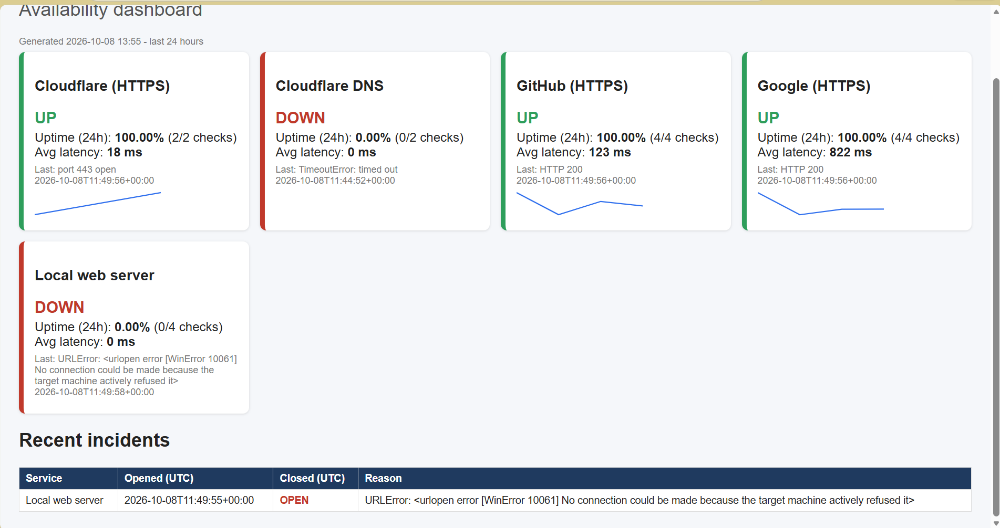
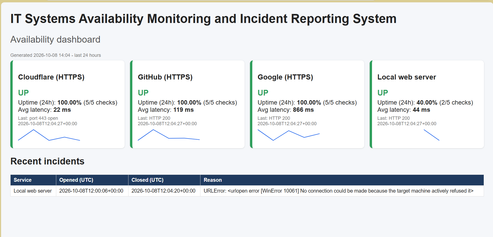

# IT Systems Availability Monitoring and Incident Reporting System (SAMS)

A small monitoring tool that checks whether websites and network services are working, records the results, raises an **incident** when something stays down, and shows everything on an easy-to-read dashboard.

> **In plain words:** it does what an IT monitoring team does, on a small scale. It keeps watching systems, spots problems quickly, and reports them clearly.

## Why I built it
I am a Computer Science student at Tshwane University of Technology. I built this project to practise real monitoring and IT support skills: finding faults, reading error messages, designing a database, and reporting on system health.

## What it does
- **Checks websites (HTTP)** - is the site answering, and how fast?
- **Checks network services (TCP)** - is a port (for example a database or mail server port) accepting connections?
- **Stores every result** in a SQLite database.
- **Opens an incident only after 3 failed checks in a row**, so a single blip does not cause a false alarm. It closes the incident when the service recovers.
- **Warns when a service is slow.**
- **Writes alerts** to the screen and to `alerts.log`.
- **Builds a dashboard** (`dashboard.html`) showing status, uptime %, average response time, a response-time graph for each service, and an incident history.

## Screenshots
**Dashboard with services UP and DOWN**



**Incident history (opened and closed)**



## How to run it
You need Python 3 only. No extra packages.

```
python sysmon.py --once      # run one round of checks
python sysmon.py             # keep running every 30 seconds (Ctrl+C to stop)
python report.py             # create dashboard.html, then open it in your browser
python -m unittest discover -s tests -v   # run the tests
```
Edit `config.json` to monitor your own websites and services.

## How the incident logic works
1. Every check result is saved.
2. If a check fails, look at the last 3 results for that service.
3. If all 3 failed and no incident is open, open one.
4. If a check succeeds while an incident is open, close it.

## Project files
| File | What it is for |
|---|---|
| `sysmon.py` | runs the checks, saves results, opens and closes incidents |
| `report.py` | builds the HTML dashboard from the database |
| `config.json` | the list of services to monitor and the settings |
| `tests/test_sysmon.py` | automated tests |

## What I learned
- How HTTP status codes and TCP connections work
- Reading network errors: during testing, port 53 was blocked on my network, so I switched that check to port 443
- Designing a small SQLite database (`checks` and `incidents` tables)
- Writing automated tests with a local test server
- Why alert thresholds matter, and why timestamps are stored in UTC

## Limitations and next steps
- It checks from one computer only
- Email or WhatsApp alerts are not added yet
- Planned: ping checks, SSL certificate expiry checks, and a live web dashboard

This is a learning project and is not meant to replace professional tools such as Zabbix or Nagios.

**Author:** Sbahle Teddy Khuzwayo - [LinkedIn](https://www.linkedin.com/in/sbahle-khuzwayob7a58423b) - sbahlekhuz2000@gmail.com
